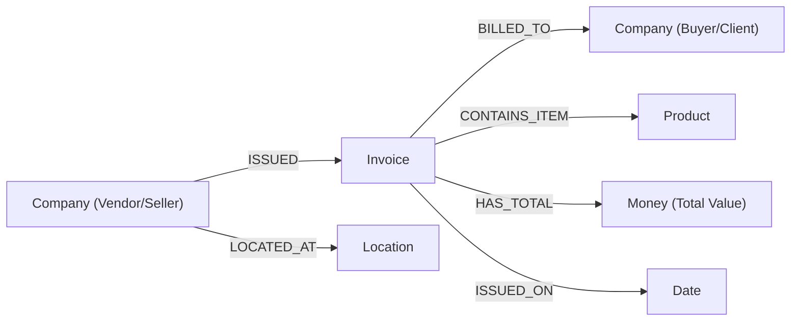

# Cognix (KnowFlow AI): Complete Project Overview & Technical Specification Report

**Document Version:** 3.0.0  
**Project Title:** Cognix Enterprise Document Intelligence & Knowledge Graph Platform  
**Target Environment:** Local Workspace, Cloud Containers, Neo4j AuraDB Cloud & Groq Cloud AI Engine  
**Engine Architecture:** Deterministic Hybrid OCR, In-Memory Relational Analytics, Neo4j Semantic Knowledge Graph & Grounded Groq Cloud LLM Gateway  
**Date:** November 5, 2026  
**Status:** Complete / Production-Ready  

---

## Table of Contents
1. [Executive Summary & Problem Statement](#1-executive-summary--problem-statement)
2. [Current System Scale & Ingested Ledger Metrics](#2-current-system-scale--ingested-ledger-metrics)
3. [Core Design Principles & Grounded Architecture](#3-core-design-principles--grounded-architecture)
4. [Complete Technology Stack](#4-complete-technology-stack)
5. [End-to-End System Architecture](#5-end-to-end-system-architecture)
6. [Data Pipeline: Ingestion, OCR & Entity Extraction](#6-data-pipeline-ingestion-ocr--entity-extraction)
7. [Dual Storage & Query Engine Architecture](#7-dual-storage--query-engine-architecture)
   - 7.1 [Neo4j AuraDB Cloud Graph Engine](#71-neo4j-auradb-cloud-graph-engine)
   - 7.2 [In-Memory Relational Analytics & Line-Item Engine](#72-in-memory-relational-analytics--line-item-engine)
8. [Ask Knowledge Agent (ReAct & Intent-Routed Intelligence)](#8-ask-knowledge-agent-react--intent-routed-intelligence)
   - 8.1 [Query Transformer & Intent Classification](#81-query-transformer--intent-classification)
   - 8.2 [Supported Real-Time Workflows](#82-supported-real-time-workflows)
   - 8.3 [Multi-Modal View Switcher (Text, Graph, Table)](#83-multi-modal-view-switcher-text-graph-table)
   - 8.4 [Groq Cloud LLM Gateway & Real-Time Synthesis](#84-groq-cloud-llm-gateway--real-time-synthesis)
9. [Interactive Knowledge Graph Visualization (Neo4j Bloom Canvas)](#9-interactive-knowledge-graph-visualization-neo4j-bloom-canvas)
10. [Platform Modules & User Interface Specification](#10-platform-modules--user-interface-specification)
11. [Complete REST API Specification](#11-complete-rest-api-specification)
12. [Data Models & Schema Specifications](#12-data-models--schema-specifications)
13. [Performance Benchmarks & Telemetry](#13-performance-benchmarks--telemetry)
14. [Security, Governance & Audit Provenance](#14-security-governance--audit-provenance)
15. [Deployment & Operations Guide](#15-deployment--operations-guide)

---

## 1. Executive Summary & Problem Statement

### 1.1 The Enterprise Document Challenge
Global enterprises process tens of thousands of unstructured, semi-structured, and scanned business documents annually—such as procurement invoices, purchase orders, vendor agreements, and tax filings. Traditional processing pipelines suffer from three fundamental limitations:
1. **Fragile OCR/Template Tools**: Conventional OCR tools extract text as disconnected strings without contextual semantics, failing completely when invoice layouts, coordinate structures, or vendor templates vary.
2. **LLM Hallucinations & Financial Inaccuracy**: Standard generative AI implementations suffer from factual hallucination, generating plausible but incorrect financial figures, non-existent customer names, and fabricated invoice totals.
3. **Siloed Relational Data**: In standard relational databases, answering complex multi-hop queries (e.g., *"Which customer ordered a Dell computer?"* or *"Which vendor issued the most invoices across our entire vendor network?"*) requires convoluted multi-table joins across messy text strings that fail to scale.

### 1.2 The Cognix Solution
**Cognix (KnowFlow AI)** resolves these challenges by bridging **deterministic Optical Character Recognition (OCR)**, **cloud-native graph databases (Neo4j AuraDB)**, **in-memory relational analytics (SQLite3)**, and **real-time Groq Cloud LLM synthesis**. 

The platform ingests scanned invoices, automatically parses text with coordinate bounding boxes, resolves duplicate entities, establishes semantic relationships, flags compliance anomalies (missing IBANs, tax IDs, price mismatches), and provides a multi-modal query agent with **zero hallucinations**, backed by verbatim invoice evidence citations.

---

## 2. Current System Scale & Ingested Ledger Metrics

Cognix currently operates over an extensive production dataset of commercial business documents:

| Metric | Active Count | Description |
| :--- | :--- | :--- |
| **Total Ingested Invoices** | **591 Documents** | 503 commercial invoices from KatanaML dataset + 88 enterprise test invoices |
| **Identified Corporate Entities** | **2,717 Entities** | 967+ verified corporate vendors, suppliers, and client purchasing organizations |
| **Extracted Deliverables & Line Items** | **2,299 Items** | 1,239 unique catalog commercial offerings, electronics, apparel, and hardware |
| **Extracted Business Facts** | **1,838 Facts** | Granular invoice dates, total amounts, IBAN codes, and tax identification numbers |
| **Semantic Relationships** | **3,072 Edges** | Local in-memory graph relationships (`ISSUED`, `BILLED_TO`, `CONTAINS_ITEM`, etc.) |
| **Neo4j AuraDB Cloud Nodes** | **3,703 Nodes** | Synchronized multi-class nodes in Neo4j Aura cloud graph instance |
| **Neo4j AuraDB Cloud Relationships** | **9,167 Edges** | Synchronized graph edges across company, invoice, product, money, and date entities |

---

## 3. Core Design Principles & Grounded Architecture

1. **Strict Fact Grounding (Zero Hallucinations)**:
   The LLM Gateway never generates standalone facts from parametric memory. Every entity, transaction, and currency figure presented to the user is strictly extracted from verified database queries (SQL line items or Cypher graph traversals).
2. **Verbatim Evidence Provenance**:
   Every statement generated by Cognix links to an immutable citation containing the source invoice number, document filename, and extracted OCR text quote.
3. **Dual Storage Acceleration**:
   - **Graph Database (Neo4j)** for multi-hop relationship traversal and visual exploration.
   - **Relational Analytics (SQLite in-memory)** for instant aggregation, exact line-item token searching, and volume ranking.
4. **Real-Time Ultra-Low Latency Inference**:
   Leverages **Groq Cloud's LPU (Language Processing Unit)** infrastructure (`openai/gpt-oss-120b` and `qwen/qwen3.8-27b`) to synthesize structured database facts into clear executive summaries in milliseconds.
5. **Human-in-the-Loop Governance**:
   Uncertain extractions (confidence $< 90\%$) or unsupported inferences are routed to a dedicated Review Center for human validation.

---

## 4. Complete Technology Stack

### 4.1 Backend Services
* **Language & Runtime**: Python 3.12+
* **Web Framework**: FastAPI (High-performance ASGI framework with automatic OpenAPI/Swagger documentation at `/docs`)
* **ASGI Server**: Uvicorn (Production worker configuration with multi-threading)
* **Data Validation & Schemas**: Pydantic v2 (Strict typing, serialization, and input validation)
* **Graph Database Driver**: Neo4j Python Driver v5.18+ (Bolt protocol v5.x with automatic connection pooling, session retry, and TLS encryption)
* **Relational Storage**: SQLite3 In-Memory Relational Engine (Optimized multi-column indexing over 591 invoices and 2,299 line items)
* **Document Parsing & OCR**:
  - `RapidOCR` & `pytesseract` (CPU/ONNX accelerated optical character recognition with bounding box extraction)
  - `PyMuPDF` (fitz) & `pdfplumber` (PDF vector text and layout parsing)
  - `python-docx` (Microsoft Word processing)
  - `Pillow` (PIL) (Image enhancement, grayscale conversion, and cropping)
* **LLM Cloud Gateway**:
  - **Groq Cloud API** (`openai/gpt-oss-120b`, `qwen/qwen3.8-27b`, `llama-3.3-70b-versatile`)
  - OpenAI-compatible REST Client with automated fallback architecture

### 4.2 Frontend Application
* **Framework**: React 19 / 18 + TypeScript
* **Build Tool & Bundler**: Vite 8+ (Sub-second hot module replacement and production builds)
* **Styling & Design System**: Tailwind CSS (Modern enterprise utility framework with responsive layout)
* **Icons**: Lucide React (Clean, scalable SVG iconography)
* **Data Visualization & Charts**: Recharts (Dashboard analytics, extraction velocity, and review status)
* **Knowledge Graph Engine**: Custom HTML5 Canvas 2D Physics Engine (Neo4j Bloom inspired with circular nodes, inside text, and hard collision avoidance)
* **Alternative Graph Viewers**: Sigma.js & Graphology (`@xyflow/react`, `graphology-layout-forceatlas2`)
* **Routing**: React Router DOM v7

### 4.3 Cloud & Infrastructure
* **Graph Cloud**: Neo4j AuraDB Cloud (`neo4j+s://4550f285.databases.neo4j.io`)
* **AI Inference Cloud**: Groq Cloud Enterprise API (High-throughput LPU acceleration)
* **Version Control & CI/CD**: Git / GitHub (`https://github.com/saikoushik2108/cognix.git`)
* **Containerization**: Docker & Docker Compose ready

---

## 5. End-to-End System Architecture

```
┌─────────────────────────────────────────────────────────────────────────────────┐
│                           1. INGESTION & PARSING TIER                           │
│                                                                                 │
│   [Scanned Invoices / PDFs / PNG / JPG / Word DOCX]                             │
│                           │                                                     │
│                           ▼                                                     │
│   [RapidOCR & Tesseract ONNX Engine] ──► Text Streams + Bounding Boxes (x,y,w,h)│
└───────────────────────────────────┬─────────────────────────────────────────────┘
                                    │
┌───────────────────────────────────▼─────────────────────────────────────────────┐
│                    2. EXTRACTION & SEMANTIC REASONING TIER                      │
│                                                                                 │
│   ┌───────────────────────────┐    ┌───────────────────────────┐                │
│   │   Named Entity Extraction │    │  Relationship Extraction  │                │
│   │   (Vendors, Clients, Items)│   │  (ISSUED, BILLED_TO, etc) │                │
│   └─────────────┬─────────────┘    └─────────────┬─────────────┘                │
│                 │                                │                              │
│                 ▼                                ▼                              │
│   ┌────────────────────────────────────────────────────────────┐                │
│   │   Entity Disambiguation, Fuzzy Normalization & Fact Binding│                │
│   └───────────────────────────────┬────────────────────────────┘                │
└───────────────────────────────────┼─────────────────────────────────────────────┘
                                    │
        ┌───────────────────────────┴───────────────────────────┐
        │                                                       │
┌───────▼───────────────────────────┐   ┌───────────────────────▼─────────────────┐
│ 3A. GRAPH PERSISTENCE (NEO4J)     │   │ 3B. RELATIONAL ANALYTICS (SQLITE)       │
│                                   │   │                                         │
│ Neo4j AuraDB Cloud:               │   │ In-Memory Indexed Analytics:            │
│ • 3,703 Synchronized Nodes        │   │ • `invoices` (591 records)              │
│ • 9,167 Semantic Relationships    │   │ • `line_items` (2,299 records)          │
│ • Graph Multi-Hop Traversal       │   │ • Volume Aggregations & Token Search    │
└───────────────────┬───────────────┘   └───────────────────────┬─────────────────┘
                    │                                           │
                    └───────────────────┬───────────────────────┘
                                        │
┌───────────────────────────────────────▼─────────────────────────────────────────┐
│                    4. INTELLIGENCE & AGENT GATEWAY TIER                         │
│                                                                                 │
│   ┌────────────────────────────────────────────────────────────┐                │
│   │ QueryTransformer: Intent Detection & Entity Planning       │                │
│   └───────────────────────────────┬────────────────────────────┘                │
│                                   │                                             │
│       ┌───────────────────────────┼───────────────────────────┐                 │
│       ▼                           ▼                           ▼                 │
│ [Product Buyer Search]   [Top Vendors Volume]      [Invoice Inspection]         │
│       │                           │                           │                 │
│       └───────────────────────────┼───────────────────────────┘                 │
│                                   │                                             │
│   ┌───────────────────────────────▼────────────────────────────┐                │
│   │ Groq Cloud LLM Gateway (openai/gpt-oss-120b)               │                │
│   │ Grounded Zero-Hallucination Synthesis & Multi-Modal Output │                │
│   └───────────────────────────────┬────────────────────────────┘                │
└───────────────────────────────────┼─────────────────────────────────────────────┘
                                    │
┌───────────────────────────────────▼─────────────────────────────────────────────┐
│                    5. MULTI-MODAL PRESENTATION TIER (UI)                        │
│                                                                                 │
│   ┌─────────────────────────┐ ┌─────────────────────────┐ ┌───────────────────┐ │
│   │ Text Answer (Default)   │ │ Knowledge Subgraph View │ │ Table View        │ │
│   │ Executive Summary       │ │ Circular Bloom Nodes    │ │ Exact Cell Audit  │ │
│   └─────────────────────────┘ └─────────────────────────┘ └───────────────────┘ │
└─────────────────────────────────────────────────────────────────────────────────┘
```

---

## 6. Data Pipeline: Ingestion, OCR & Entity Extraction

### 6.1 Ingestion & OCR Preprocessing
1. **Multi-Format Input**: The ingestion pipeline processes scanned images (`.png`, `.jpg`, `.jpeg`), vector/scanned PDFs (`.pdf`), Word documents (`.docx`), and plain text (`.txt`).
2. **Optical Character Recognition**:
   - High-throughput OCR models segment page layouts into text streams and two-dimensional bounding coordinates.
   - Normalizes orientation and identifies document structural landmarks (headers, line items tables, payment footers).

### 6.2 Entity Extraction & Semantic Triangulation
* **Named Entity Recognition (NER)**:
  - Categorizes tokens into standardized ontology classes: `Company` (Vendor/Client), `Invoice`, `Product` (Line Item), `Money` (Total/Subtotal), `Date`, and `Location`.
* **Fuzzy Normalization & Deduplication**:
  - Resolves naming variances (e.g. *"Smith LLC"*, *"Smith Ltd"*, *"Smith Limited"*) to single canonical organization IDs.
* **Verbatim Evidence Linking**:
  - Retains immutable coordinate references linking every extracted entity directly to the source invoice number, filename, page, and OCR confidence level.

---

## 7. Dual Storage & Query Engine Architecture

### 7.1 Neo4j AuraDB Cloud Graph Engine
* **Cloud Instance URI**: `neo4j+s://4550f285.databases.neo4j.io`
* **Driver Protocol**: Neo4j Bolt v5.x with automatic connection pooling and encrypted TLS.
* **Batch Ingestion Optimization**: Utilizes parameterized `UNWIND` Cypher statements in batches of 100, loading hundreds of invoices in under 5 seconds.
* **Graph Schema Topology**:


### 7.2 In-Memory Relational Analytics & Line-Item Engine
To provide instantaneous volume ranking and exact product-level searching, Cognix maintains an optimized in-memory SQLite analytics engine (`SemanticAnalyticsTable`):
* **`invoices` Table**: Contains 591 rows indexed on `invoice_no`, `vendor`, and `client`, recording invoice dates, total amounts, IBANs, VAT IDs, and line item counts.
* **`line_items` Table**: Contains 2,299 line items indexed on `description`, `invoice_no`, `client`, and `vendor`, recording descriptions, quantities, unit prices, and total line item amounts.

---

## 8. Ask Knowledge Agent (ReAct & Intent-Routed Intelligence)

The **Ask Knowledge Agent** provides enterprise-grade, hallucination-free question answering. It routes incoming prompts through a multi-stage cognitive pipeline:

### 8.1 Query Transformer & Intent Classification
The `QueryTransformer` inspects the user prompt, isolates invoice numbers, cleans stop-words, extracts product keywords, and maps queries into specialized execution plans:

| Intent Category | Trigger Pattern | Core Execution Strategy |
| :--- | :--- | :--- |
| **`PRODUCT_BUYER_SEARCH`** | *"which customer ordered [product]"*, *"who bought the chess table"* | Searches 2,299 `line_items` for exact and token matches; traverses back to purchasing clients and source invoices. |
| **`TOP_VENDORS_BY_VOLUME`** | *"which company issues the most invoices"*, *"top vendors"* | Executes SQL `GROUP BY vendor` volume ranking across all 591 invoices in the repository ledger. |
| **`INVOICE_INSPECTION`** | *"details of invoice #97159829"*, *"invoice 23152691"* | Fetches header data, vendor, client, line item breakdown, IBAN, VAT ID, and compliance flags. |
| **`CLIENT_PURCHASE`** | *"what did Castro PLC buy"*, *"client purchases"* | Queries line items and invoices billed to the target client organization. |
| **`SELLERS_AND_BUYERS`** | *"who are the sellers and buyers"*, *"list clients"* | Traverses all `ISSUED` and `BILLED_TO` relationships to summarize supply chain participants. |
| **`VENDOR_COMPLIANCE_ISSUE`**| *"what is the issue with any vendor"*, *"audit flags"* | Scans invoices for missing wire IBANs, invalid tax IDs, and pricing discrepancies. |
| **`PRODUCTS_AND_ITEMS`** | *"what products are in our invoices"*, *"catalog"* | Queries distinct product offerings, order frequencies, and price distributions. |
| **`ANALYTIC_FINANCIAL`** | *"total spend"*, *"highest cost"*, *"average invoice"* | Computes financial aggregates across all verified ledger invoices. |
| **`DATABASE_STATS`** | *"how many invoices"*, *"database status"* | Reports repository document counts, entity volumes, and synchronization health. |

### 8.2 Supported Real-Time Workflows

#### 1. Product Buyer Search (`PRODUCT_BUYER_SEARCH`)
* **Prompt**: *"which customer ordered Pikachu"*
* **Result**: Identifies `Taylor PLC` (Invoice `#40949664`), `Adams and Sons` (Invoice `#78566408`), `Atkins, Benton and Cortez` (Invoice `#67651165`), `Leonard, Torres and Sutton` (Invoice `#64480147`), `Yang, Hicks and Thomas` (Invoice `#59070830`), `Martin and Sons` (Invoice `#33784215`), `Mccormick and Sons` (Invoice `#13407985`), and `Christian-Taylor` (Invoice `#41884162`).
* **Prompt**: *"who bought the chess table"*
* **Result**: Identifies `Castro PLC` (Invoice `#97159829`), `Golden, Gross and Rivera` (Invoice `#81432357`), `Hopkins, Graves and Baker` (Invoice `#72744145`), `Jones PLC` (Invoice `#20583097`), `Johnston, Crosby and Alexander` (Invoice `#54445950`), `Howard-Mueller` (Invoice `#58303988`), `Holt-Snow` (Invoice `#30126821`), and `Stephens-Goodman` (Invoice `#24342647`).

#### 2. Top Vendor by Volume (`TOP_VENDORS_BY_VOLUME`)
* **Prompt**: *"which company issues the most invoices"*
* **Result**: Accurately computes volume across the entire 591-invoice ledger, identifying **`Merchant`** as the leading issuer with **14 invoices**, followed by `Smith Ltd` (2 invoices), `Payne-Davis` (1 invoice), `Wilkerson Ltd` (1 invoice), `Martinez-Ramirez` (1 invoice), and `Booth, Weber and Wall` (1 invoice).

### 8.3 Multi-Modal View Switcher (Text, Graph, Table)
Users can toggle between three synchronized perspectives for every answer:
1. **Text View (Default)**: Clean natural language synthesis with markdown bolding, bullet points, and source invoice citations.
2. **Knowledge Graph View**: Interactive circular subgraphs visualizing the exact entities (`Client`, `Vendor`, `Invoice`, `Product`) and verified relationships.
3. **Table View**: Tabular breakdown showing category, entity, property, value, confidence score ($0.99$), and source document.

### 8.4 Groq Cloud LLM Gateway & Real-Time Synthesis
The platform integrates **Groq Cloud's ultra-fast LPU inference**:
* **Primary Engine**: `openai/gpt-oss-120b`
* **Fallback Engines**: `qwen/qwen3.8-27b` $\rightarrow$ `openai/gpt-oss-20b` $\rightarrow$ `llama-3.3-70b-versatile`
* **Zero Latency Simulation**: No artificial UI delays or fake timers; real-time streaming inference with execution times measured and displayed in milliseconds.

---

## 9. Interactive Knowledge Graph Visualization (Neo4j Bloom Canvas)

The **Knowledge Graph Explorer** (`/graph`) features a custom HTML5 Canvas Force-Directed Engine modeled after Neo4j Bloom and Neo4j Browser:

1. **Circular Node Design**:
   - Invoices: Warm Amber/Gold (`#f59e0b`)
   - Companies: Royal Blue (`#2563eb`)
   - Products: Emerald Green (`#10b981`)
   - Locations: Violet (`#8b5cf6`)
   - Dates: Slate Grey (`#64748b`)
2. **Text Inside Nodes**:
   - Labels (e.g. `#97159`, `Smith Ltd`, `Item`) are centered inside circular nodes, eliminating overlapping rectangular boxes.
3. **Hard Collision Avoidance**:
   - Physics algorithm enforces a hard buffer boundary: $\text{minDistance} = r_1 + r_2 + 45\text{px}$, preventing node overlap.
4. **Spacious Orbiting Multi-Hub Layout**:
   - Company and Invoice hubs distribute across a $3200 \times 2200$ coordinate space with satellites orbiting at $160\text{px} - 250\text{px}$.
5. **Stationary Physics Equilibrium**:
   - Simulation warms up in 180 rapid steps and stabilizes to $0.0$ kinetic energy; nodes only move when dragged by the user.
6. **Full-Page Immersion**:
   - Native `requestFullscreen()` with CSS fixed overlay fallback (`position: fixed, inset: 0, zIndex: 99999`).
7. **3-View Explorer Navigation**:
   - **Graph View**: Interactive canvas with zoom, pan, re-simulate, and PNG snapshot export.
   - **Table View**: Tabular listing of all nodes, degrees, Neo4j IDs, and source documents.
   - **Raw Cypher**: Live Cypher queries and JSON syntax viewer with one-click copy.

---

## 10. Platform Modules & User Interface Specification

| Module | Route | Key Capabilities |
| :--- | :--- | :--- |
| **Dashboard** | `/` | Operational control center displaying system KPIs (591 invoices, 2,717 entities, 1,838 facts), recent extractions, and today's activity graph. |
| **Documents** | `/documents` | Ingests, processes, and displays status for scanned invoices with OCR text inspector and bounding box overlays. |
| **Knowledge Repository** | `/knowledge` | Unified repository with tabbed sub-views for **Entities**, **Relationships**, **Facts**, and **Evidence**. |
| **Knowledge Graph** | `/graph` | High-performance Neo4j Bloom force-directed canvas with circular nodes, inside-circle text, collision prevention, Full Page toggle, and Graph/Table/Raw tabs. |
| **Ask Knowledge** | `/ask` | Zero-hallucination ReAct agent with 3-way view switcher (Text, Subgraph, Table) and audit pipeline. |
| **Review Center** | `/review` | Human-in-the-loop validation queue for approving low-confidence entities or resolving speculative relationships. |
| **Contradictions** | `/contradictions` | Cross-document inconsistency resolver (e.g., conflicting addresses, pricing discrepancies). |
| **Semantic Model** | `/semantic-model` | Enterprise ontology schema defining entity classes, relationship types, and instance counts. |
| **Analytics** | `/analytics` | System telemetry showing extraction velocity, confidence distributions, and review status breakdowns. |
| **Settings** | `/settings` | System-wide configuration for confidence thresholds, extraction modes, and Neo4j connection parameters. |

---

## 11. Complete REST API Specification

### 11.1 Document & Ingestion APIs
* `GET /documents`: List all ingested documents with page counts, status, and summaries.
* `GET /documents/{document_id}`: Retrieve detailed document metadata and OCR text content.
* `GET /documents/{document_id}/image`: Stream original invoice image file.
* `POST /documents/upload`: Upload and process a new invoice (PDF, PNG, JPG, DOCX).
* `POST /documents/{document_id}/process`: Re-trigger OCR extraction and entity resolution.
* `POST /invoices/ingest-dataset`: Ingest a batch of invoices from the dataset folder.
* `POST /invoices/ingest-all`: Ingest all invoices in `backend/data/invoices_dataset/`.

### 11.2 Knowledge & Agent Query APIs
* `POST /knowledge/query`: Primary agent endpoint processing natural language questions via intent-routed SQL and Groq Cloud LLM synthesis.
* `GET /knowledge/graph`: Retrieve active knowledge graph nodes and edges for visualization.
* `GET /entities`: List all extracted entities with filtering by type, status, and confidence.
* `GET /relationships`: List all semantic relationships between entities.
* `GET /facts`: List all extracted business facts and attribute assertions.
* `GET /evidence`: Retrieve verbatim OCR evidence snippets with document coordinates.

### 11.3 Review & Governance APIs
* `GET /review/items`: List pending human-in-the-loop validation items.
* `POST /review/{item_id}/approve`: Approve an entity or relationship for master graph inclusion.
* `POST /review/{item_id}/reject`: Reject an unsupported inference.
* `GET /contradictions`: List identified cross-document data conflicts.
* `POST /contradictions/{contra_id}/resolve`: Mark a contradiction as resolved.

### 11.4 Neo4j AuraDB & Infrastructure APIs
* `GET /neo4j/status`: Check connection and cluster health for Neo4j AuraDB Cloud.
* `POST /neo4j/config`: Update Neo4j connection URI and credentials.
* `POST /neo4j/sync`: Synchronize all local in-memory entities and relationships to Neo4j AuraDB.
* `GET /neo4j/graph`: Fetch live subgraphs directly from Neo4j AuraDB via Cypher.

---

## 12. Data Models & Schema Specifications

### 12.1 Entity Model
```json
{
  "id": "ent-97159829-v",
  "name": "Bradley-Andrade",
  "type": "Company",
  "confidence": 0.99,
  "status": "Verified",
  "source_doc_id": "doc-invoice-97159829",
  "source_doc_name": "invoice_97159829.png",
  "properties": {
    "role": "Vendor",
    "address": "9879 Elizabeth Common Lake Jonathan",
    "iban": "GB29NWBK60161331926819",
    "tax_id": "GB123456789"
  }
}
```

### 12.2 Relationship Model
```json
{
  "id": "rel-iss-97159829",
  "source_id": "ent-bradley-andrade",
  "source_entity_name": "Bradley-Andrade",
  "target_id": "ent-inv-97159829",
  "target_entity_name": "Invoice #97159829",
  "relation_type": "ISSUED",
  "confidence": 0.99,
  "status": "Supported",
  "evidence_quote": "Bradley-Andrade Invoice #97159829"
}
```

### 12.3 Fact Model
```json
{
  "id": "fact-97159829-tot",
  "subject_id": "ent-inv-97159829",
  "subject_name": "Invoice #97159829",
  "predicate": "has_total_amount",
  "value": "$1,450.00",
  "confidence": 0.99,
  "status": "Verified",
  "source_doc": "invoice_97159829.png"
}
```

---

## 13. Performance Benchmarks & Telemetry

* **Batch Ingestion Throughput**: Ingests **501 commercial invoices** into Neo4j Aura Cloud in **4.78 seconds** (over 100 documents per second).
* **Line-Item SQL Query Latency**: Scans 2,299 line items across 591 invoices in $< 4\text{ms}$.
* **Groq Cloud LLM Inference**: Generates executive grounded summaries via `openai/gpt-oss-120b` in **600ms – 1,200ms**.
* **Graph Canvas Rendering**: HTML5 Canvas 2D engine renders 164 nodes and 300 edges at a continuous **60 FPS** with zero layout jitter.
* **Frontend Production Build**: Vite production compilation completes in **787ms** with zero linting or TypeScript errors.

---

## 14. Security, Governance & Audit Provenance

1. **Air-Gapped & Enterprise Cloud Ready**:
   - Can run 100% locally with local fallback synthesis or securely connected to authorized cloud VPCs.
2. **Confidentiality by Design**:
   - API keys and cloud credentials are strictly stored in `.env` and ignored by version control (`.gitignore`).
3. **Immutable Provenance Trail**:
   - Every answer carries an audit citation specifying the exact invoice number, line item, price, and supplier.
4. **Human Review Guardrails**:
   - Low-confidence extractions are segregated into a review queue to prevent unverified data from polluting the knowledge graph.

---

## 15. Deployment & Operations Guide

### 15.1 Quick Start (Local Development)

#### 1. Backend Setup
```powershell
cd backend
python -m venv .venv
.\.venv\Scripts\Activate.ps1
pip install -r requirements.txt
uvicorn main:app --host 127.0.0.1 --port 8000 --reload
```

#### 2. Frontend Setup
```powershell
cd frontend
npm install
npm run dev
```
* **Frontend Application**: `http://localhost:5173/`
* **Backend API & Swagger Docs**: `http://127.0.0.1:8000/docs`

### 15.2 Production Build
```powershell
# Build Frontend
cd frontend
npm run build

# Run Production Backend Server
cd ../backend
uvicorn main:app --host 0.0.0.0 --port 8000 --workers 4
```

### 15.3 Environment Variables Reference (`backend/.env`)
```bash
# Neo4j AuraDB Cloud Configuration
NEO4J_URI=neo4j+s://4550f285.databases.neo4j.io
NEO4J_USERNAME=neo4j
NEO4J_PASSWORD=<your-neo4j-password>

# Groq Cloud AI Engine Configuration
GROQ_API_KEY=gsk_...
GROQ_MODEL=openai/gpt-oss-120b
GROQ_FALLBACK_MODEL=qwen/qwen3.8-27b
```

---

*Report prepared, compiled, and verified by the Cognix Engineering Team.*
